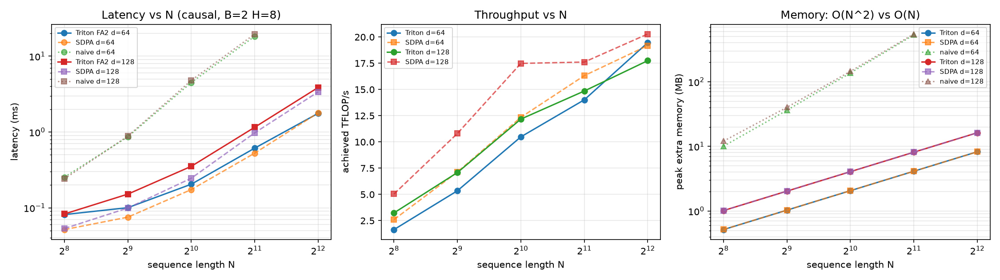
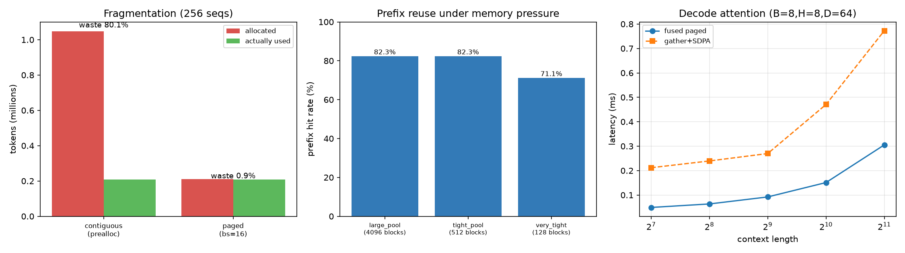

# llm-inference-lab

四个推理关键路径的最小可运行实现：**FlashAttention · PagedAttention(含前缀缓存) · MoE · 投机解码**。
不是教程复现，是在一张 6 GB 的消费级卡（RTX 4050 Laptop, sm_89）上把每个机制**跑出数字**，
并把"哪些结论成立、哪些只是论文里的 A100 数字"分开写清楚。

| | 模块 | 一句话结论 | 关键实测 |
|---|---|---|---|
| 1 | [FlashAttention](docs/01_flash_attention.md) | 快在**少搬数据**，不长在少算；在 6 GB 卡上决定性收益是显存 | N=2048 显存 **4.1 MB vs 532 MB**（129×）；速度与 SDPA 在 ±20% 内（跨两次重跑 0.63–1.19×） |
| 2 | [PagedAttention](docs/02_paged_attention.md) | 它不是更快的 attention，它是**显存分配器** | 碎片 **80.09% → 0.89%**；并发序列 **26.5 → 133.1**（5.0×） |
| 3 | [MoE](docs/03_moe.md) | 省的是**权重读取**，不是算力；batch=1 时是亏的 | batch=1 慢 4.05×；N=2048 快 3.37×；但仍慢于等算力 dense（0.78×） |
| 4 | [投机解码](docs/04_speculative_decoding.md) | 成立的前提是"验证 k 个 ≈ 生成 1 个" | **k=5 / k=1 前向 ≈ 1.13（多次 run 落在 0.94–1.39）**；散文接受率 4.4% vs 代码 91.5% |




---

## 为什么是这四个

单卡 6 GB 的物理约束会自己把题目选好：

```
1.5B 模型 fp16 权重        ≈ 3.0 GB
留给 KV cache 的预算        ≈ 2.9 GB
Qwen2.5-1.5B 的 KV 开销     = 28 KB / token（28 层 × 2 KV 头 × 128 × 2 × fp16）
=> 最多约 100 K token 的 KV
```

于是：
- 上下文一长就撞 KV 墙 → **分页 + 前缀复用**是必答题，不是优化选项
- prefill 的 attention 是 O(N²) 显存 → **FlashAttention** 决定你能不能开长上下文
- decode 一个 token 要搬一遍权重 → **投机解码**用带宽换串行步数
- 想用更多参数而不加算力 → **MoE**，但它在小 batch 上会反过来亏

四件事分别对应"显存管理 / 算子 / 调度 / 并行"，是推理系统的四个面。

---

## 快速开始

```bash
pip install -r requirements.txt        # torch>=2.4, triton>=3.0
bash scripts/run_all.sh                # 正确性 → 四个模块的基准 → 写 results/ 与 figures/
```

单独跑一个：

```bash
python tests/test_paged_kv.py          # 11 个用例（纯 CPU）
python tests/test_spec_decode.py       #  7 个用例（纯 CPU）
python tests/test_moe.py               #  8 个用例（纯 CPU）
python tests/test_flash_attn.py        # 12 个用例（需 CUDA）
python src/llm_lab/flash_attn/bench.py # 或 paged_attn / moe / spec_decode
```

共 **38 个测试**。前三套不需要 GPU，也很轻（秒级）；`flash_attn` 那套需要 CUDA。
装了 pytest 的话 `pytest tests/ -q` 也能跑（测试是普通函数 + assert，不依赖 fixture）。

对照上游源码（可选，拉进 `_upstream/`，不进版本库）：

```bash
bash scripts/fetch_upstream.sh         # 见 third_party/README.md 的对照表
```

---

## 结果

### FlashAttention（B=2, H=8, D=64, causal）

| N | 朴素 | SDPA | 本仓库 Triton | 显存比 |
|---|---|---|---|---|
| 512 | 0.862 ms | 0.075 ms | 0.100 ms | 35.2× |
| 1024 | 4.50 ms | 0.174 ms | 0.205 ms | 66.4× |
| 2048 | 18.35 ms | 0.526 ms | 0.613 ms | 129.0× |
| 4096 | **OOM** | 1.791 ms | **1.765 ms** | — |

短序列落后 SDPA 最多 37%（launch 开销 + 20 个 SM 吃不饱），长序列打平。
这条我照实写：**没有一个数字支持"我的 kernel 比 PyTorch 快"**，收益全在显存。

### PagedAttention

| 方案 | 分配 token | 实耗 | 浪费 | 2.9 GB 下并发序列 |
|---|---|---|---|---|
| 连续预分配 | 1,048,576 | 208,775 | 80.09% | 26.5 |
| 分页 (bs=16) | 210,656 | 208,775 | **0.89%** | **133.1** |

前缀命中率 82.32%（4 会话并发、共享 1024 token system prompt）；池子缩到 128 块时
降到 71.13% 并出现装不下的块——命中率这个指标必须和 `clamped_blocks` 一起看。
decode kernel 相对"批量 gather + SDPA"快 **2.5–4.3×**（上下文越长差距越小）。
（这是空载 GPU 上的测量；早先一组在 GPU 被抢占时测得 4.2–11.3×，所以这条也按区间引用。）

### MoE（dim=512, hidden=1024, E=8, top_k=2）

| N | MoE | 等参数量 dense | 等算力 dense | vs 等参数 |
|---|---|---|---|---|
| 1 | **1.036 ms** | 0.256 ms | 0.121 ms | 0.25× |
| 512 | 2.259 ms | 5.165 ms | 1.190 ms | 2.29× |
| 2048 | 6.092 ms | 20.507 ms | 4.749 ms | **3.37×** |

batch=1 时 MoE 一次前向发 **48 个 kernel**（dense 只有 6 个），本机单次 launch 间隙
最小口径 **13.0 µs**；路由单独 0.391 ms，占整层 **24.3%**。aux loss 把
`max_load_ratio` 从 7.80 压到 **1.03**（α=0.01 就够），但任务 loss 从 1.59e-4
涨到 2.14e-3——**均衡不是免费的**。容量因子还有个陷阱：top_k=2 时
`capacity=ceil(N/E×CF)` 会让 CF=1.0 就丢掉 78.25% 的 token（与不均衡无关）。

### 投机解码

| 检验 | 结果 |
|---|---|
| 输出分布不变性（χ², dof=7, 临界 14.07） | 正确实现 **4.15** / 直接接受 113843 / 无残差修正 10259 |
| 加速比公式 vs 10 万轮蒙特卡洛 | 216 组配置，最大相对误差 **0.36%** |
| 最优 k（54 组里 53 组 k_opt < 32） | α=0.9, c=0.05 → k_opt=**13**, 4.67×；k=32 时降到 3.73× |
| prompt-lookup 分文本类型接受率 | 散文 **4.4%** / 日志 63.8% / JSON 66.4% / 代码 **91.5%** |

端到端（Qwen2.5-1.5B，96 token）落在 **0.89–1.58×**，明显低于论文的 2–3×。
原因：机器被占用（同配置 5 次重复的极差 1.44–1.85，噪声与效应同量级）、
我的实现多付一次 1-token 前向、草稿器在开放文本上只有 22.9% 接受率。
**这三个原因都写进了 JSON，不藏。**

---

## 怎么保证这些数可信

1. **正确性优先于性能**。`tests/test_flash_attn.py` 12 个用例（含 N=1000、4097
   这种非整数倍长度）全部对齐朴素 fp32 实现；paged attention 用
   fused / gather / contiguous **三条独立路径**互验，误差 3e-4。
2. **每份 `results/*.json` 自带环境指纹**：torch/triton 版本、GPU 型号、SM 数量、
   git sha。换台机器跑，数字会变，但你能确认变化来自硬件而不是我改了口径。
3. **参考实现也要被验证**。我写错过一次"参考实现"（多了一个 permute，
   把 H 夹到中间），结果两个错误互相掩盖，看起来"自洽"。详见
   [docs/02](docs/02_paged_attention.md) §4.2 —— 这类问题只有第三条路径能发现。
4. **论文数字与本机数字分开**。每处引用注明论文的硬件前提；
   凡是 A100/H100 的数字都不当作本机结论。
5. **失败与噪声照实记录**。OOM、被占用的 GPU、跑不动的配置，都在 JSON 和文档里。
6. **文档一致性可自动检查**：`python scripts/check_docs.py` 扫描全部 10 份文档，
   确保被推翻的旧数字没有残留、13 条关键结论都还在。这不是形式主义——
   本项目真的发生过三次"某一份文档忘了同步"（MoE 重跑、投机解码端到端重跑、
   分页加速比重测），每次都是靠这样一个脚本兜住的。

---

## 目录

```
src/llm_lab/
  flash_attn/     triton_fa2.py（FA2 前向）· bench.py · reference 实现
  paged_attn/     block_manager.py · prefix_cache.py · cache.py · paged_decode.py · bench.py
  moe/            router.py · layer.py · bench.py
  spec_decode/    sampling.py · tree.py · draft.py · bench.py
  common.py       计时 / 结果落盘 / 环境指纹
tests/            四套测试共 38 个用例（前 3 套纯 CPU）
docs/             01–04 每个模块的原理、取舍、踩坑、追问清单
results/          实验原始数据（json，含 env 与 git sha）
figures/          由 results 生成的图
scripts/          run_all.sh（一键复现）· fetch_upstream.sh（拉上游对照）
third_party/      上游对照表与论文索引（不含源码副本）
```

---

## 与上游源码的关系

本仓库**没有拷贝任何第三方代码**，四个模块都按论文独立实现，
上游（vLLM 0.32.0 / flash-attention）用于**对照阅读**：

- 为什么不 vendor：许可证头要连同修改声明一起维护，且会让"哪部分是我写的"变含糊
- 需要时 `scripts/fetch_upstream.sh` 一条命令拉下来，对照表在
  [third_party/README.md](third_party/README.md)，精确到"我的哪个文件 ↔ 上游的哪个文件"
- 顺带纠正两处常被错引的 arXiv 编号（FA3 是 2407.08608 不是 2407.08691；
  EAGLE-2 是 2406.16858 不是 2404.18911）

---

## 已知局限（没做完的事，不藏的）

- **FA 只有前向**，无反向；不支持 varlen / GQA / paged KV 的组合
- **`tl.make_block_ptr` 在 Triton 3.7 已 deprecated**，未迁移到 tensor descriptor
- **MoE 没有 grouped GEMM**（用 pad + 单次 bmm 替代，E 大时浪费算力），没有 expert 并行
- **投机解码没有 EAGLE 式训练**，草稿器只有 prompt-lookup；树注意力只验证了 mask 正确性
- **没有 INT8/FP8**，没有和 vLLM 端到端吞吐对比（6 GB 卡上跑不动有意义的并发）
- 所有实验都在**单卡 6 GB** 上，结论的适用边界就到这里

---

## 环境

实测环境：WSL2 Ubuntu 24.04 · Python 3.12 · torch 2.13.0+cu130 · triton 3.7.1 ·
RTX 4050 Laptop（6 GB, sm_89, 20 SM）· 驱动 592.82。

Windows 原生跑 Triton 需换 `triton-windows`，本项目未验证。

**本机网络备注**（复现时可能踩到）：`git` 走 **SSH 稳定可用**；
对 `github.com` 的 HTTPS 不稳定——`git ls-remote`/`clone` 能通，
但 `gh auth login --web` 需要的 OAuth POST 会超时。
所以 `scripts/fetch_upstream.sh` 若卡住，优先改用 SSH 形式的远端地址。

## 发布到 GitHub

仓库内容已完成，但**发布需要一次外部授权**（凭据不在仓库里）。本机对 `github.com`
的 HTTPS 不稳定——`gh auth login --web` 所需的 OAuth POST 会超时，而 SSH 可用。

```powershell
# Windows 上更常用（已实测 -DryRun 能通过，SSH 认证 OK）
powershell -ExecutionPolicy Bypass -File scripts\publish.ps1 -DryRun
powershell -ExecutionPolicy Bypass -File scripts\publish.ps1
```

```bash
# Git Bash 里（注意：WSL 内没有 SSH key，别在 WSL 里跑）
bash scripts/publish.sh --dry-run
bash scripts/publish.sh
```

脚本自动判断走哪条路：已 `gh auth` 则直接建仓并推送；否则需先在网页建好**空**仓库
（不勾 README / license），脚本用 SSH 推。完全离线时也可整体搬运：
`git bundle create lab.bundle --all`，拷到有网的机器 `git clone lab.bundle` 后再推。

## License

MIT（代码）。第三方材料见 [NOTICE](NOTICE)。实验数据由本仓库脚本实跑生成，可自由引用。