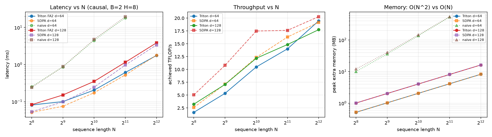
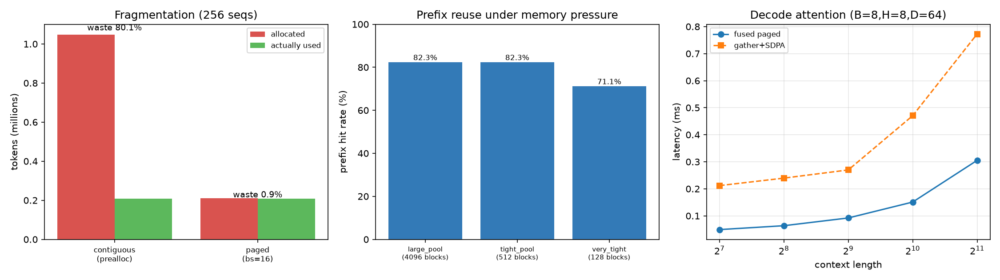
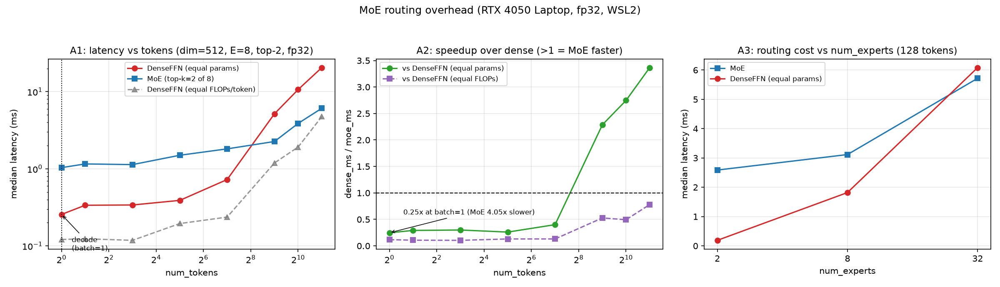
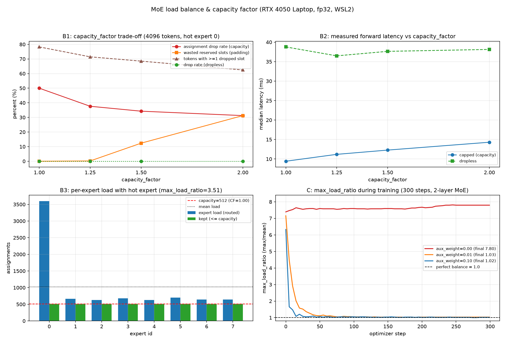
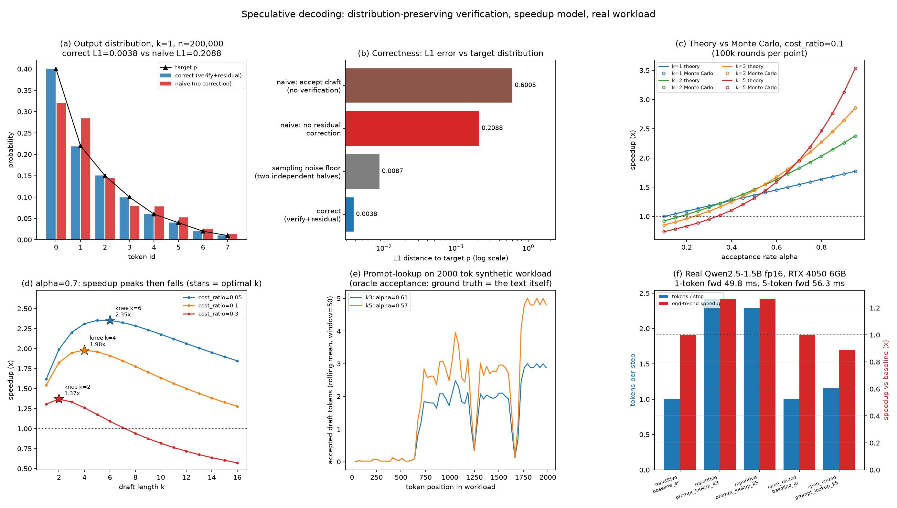

# 单卡 6 GB 环境下的推理关键路径实测

### —— FlashAttention / PagedAttention / MoE / 投机解码 的边界与代价

**摘要**　本文在单张 6 GB 消费级 GPU（RTX 4050 Laptop, sm_89）上，对当前大模型推理的四个关键机制各做了一份可复现的最小实现与实测：FlashAttention-2（Triton 自写前向）、PagedAttention（块管理 + 链式哈希前缀缓存 + 分页 decode 内核）、MoE（top-k 路由 + 容量因子 + 负载均衡损失）、投机解码（拒绝采样验证 + 树状注意力 + 接受率模型）。所有代码、原始数据与作图脚本随文提交。主要发现：**FlashAttention 在该环境下的决定性收益是显存（N=2048 时 129×）而非速度（长序列仅与 PyTorch SDPA 持平）；PagedAttention 的收益来自碎片消除（浪费率 80.09% → 0.89%，同预算并发序列 26.5 → 133.1）而非内核本身（分页内核单请求反而更慢）；MoE 在 batch=1 时因 kernel launch 与 gather/scatter 开销而净亏，需 N≥1024 才反超等参数量 dense，且始终不及等算力 dense；投机解码的可行性前提是"验证 k 个 token 与生成 1 个 token 代价近似相同"（实测 k=5/k=1 为 1.13，跨 run 落于 0.94–1.39），其收益由文本可预测性主导（同一草稿器在散文上接受率 4.4%、在代码上 91.5%）。本文同时给出五条有效性威胁，明确这些结论的适用边界。**

---

## 1　背景与目标

### 1.1 为什么是这四个

单卡 6 GB 的显存约束会把题目自己选出来。以 Qwen2.5-1.5B（28 层、2 个 KV 头、
head_dim 128、fp16）为例：

```
权重               ≈ 3.0 GB
留给 KV cache       ≈ 2.9 GB
每 token 的 KV      = 2 × 2 × 128 × 2 B × 28 = 28 KB
可容纳 KV           ≈ 100 K token
```

于是四个机制分别对应四类瓶颈：

| 瓶颈 | 对应机制 |
|---|---|
| 长上下文的 attention 中间量是 O(N²) 显存 | FlashAttention |
| KV cache 的碎片与不可复用 | PagedAttention + 前缀缓存 |
| decode 每步要搬一遍权重 | 投机解码 |
| 想加参数而不加算力 | MoE |

### 1.2 目标与不做的部分

目标是**给出边界，而不是刷新指标**。因此每个模块都必须回答三个问题：
(1) 机制是否被正确实现（可验证的正确性）；(2) 在 6 GB 单卡上收益/损失是多少；
(3) 收益的来源是什么，换到别的硬件上会不会翻转。

明确不做：训练侧实现、多卡 / expert 并行、与 vLLM 的端到端吞吐对标
（6 GB 上无法构造有意义的并发负载）。

---

## 2　实验环境与测量方法

| 项 | 值 |
|---|---|
| GPU | NVIDIA RTX 4050 Laptop，6 GB，sm_89，20 SM |
| 驱动 / CUDA | 592.82 / CUDA 13.0 |
| 软件栈 | WSL2 Ubuntu 24.04，Python 3.12，torch 2.13.0+cu130，triton 3.7.1 |
| 上游对照 | vLLM 0.32.0（仅读源码，见 §7） |

**测量方法上的三个选择**，直接影响数字是否可信：

1. **用 CUDA event 而不是墙钟计时**。kernel 是异步的，墙钟会把 launch 开销
   算进计算时间；在小 kernel 上这一项可以让误差达到数倍。
2. **计时前先 warmup**。GPU 需要进入稳定时钟。MoE 那组实验额外做了 2 秒的
   预热负载（`warmup_burn_s`），并在 JSON 里记录了实验前后的 SM 频率与温度，
   避免把频率爬升当成性能差异。
3. **取中位数而非均值**。同一张卡上还有其它进程时，均值会被离群点拉高；
   中位数更接近稳定态。同时记录 `min` 与 `p90` 以便判断离散程度。

每份原始数据（`results/*.json`）都写入 torch/triton 版本、GPU 型号、SM 数量、
时间戳与 git sha，使"这个数字是在哪台机器上跑出来的"可追溯。

---

## 3　FlashAttention

### 3.1 实现

`src/llm_lab/flash_attn/triton_fa2.py`。按 Dao (2023) 的 FlashAttention-2 实现前向：
沿 K/V 序列维分块，在片上做 online softmax（维护运行最大值 m 与运行和 l），
中间矩阵 S、P 从不写回 HBM。三处工程决策：

- **STAGE 分离**：把循环拆成"恒定的因果区（无需 mask）"与"对角区（需三角 mask）"，
  `IS_CAUSAL` 作为 `tl.constexpr`，因果与非因果编译成两个 kernel，无运行期分支。
- **`EVEN_N` 常量**：N 非 BLOCK 整数倍时，尾部块若只依赖 `boundary_check` 补零，
  补出的零会被当作"相似度为 0 的有效 key"污染 softmax 分母。宿侧算出
  `EVEN_N = (N % BLOCK_N == 0)` 传入，False 时才走显式掩码分支，
  快路径不付代价。
- **tile 受两条硬约束**：Ada 每 SM 约 99 KB shared memory，`D=256, BLOCK_N=64,
  num_stages=3` 实测需要 212992 B 而超限，故 D=256 退到 `64/32/stages=2`；
  同时 `acc`（`BLOCK_M × HEAD_DIM` fp32）吃寄存器，`BLOCK_M` 不能无限加大。

### 3.2 正确性

12 个用例覆盖 `N ∈ {64, 128, 256, 1000, 1024, 4097}`、`D ∈ {64, 128, 256}`、
causal 与非 causal，全部与朴素 fp32 实现对齐（最大绝对误差 ≤ 1.95e-3，
fp16 舍入量级），`lse` 形状自检通过。

其中 N=1000 与 N=4097 是刻意的：非整数倍长度是这类内核最常见的**静默错误**来源。

### 3.3 结果



| N | 朴素实现 | SDPA | 本文 Triton | 显存比（朴素/Triton） |
|---|---|---|---|---|
| 256 | 0.253 ms | 0.052 ms | 0.081 ms | 19.5× |
| 512 | 0.862 ms | 0.075 ms | 0.100 ms | 35.2× |
| 1024 | 4.50 ms | 0.174 ms | 0.205 ms | 66.4× |
| 2048 | 18.35 ms | 0.526 ms | 0.613 ms | **129.0×** |
| 4096 | OOM | 1.791 ms | **1.765 ms** | — |

（B=2, H=8, D=64, causal；单位 ms，中位数）

### 3.4 讨论

三条结论，按重要性排序：

1. **显存是数量级差异，速度不是。** N=2048 时中间量显存 532 MB vs 4.1 MB。
   朴素实现在 N=4096 直接 OOM（fp32 的 S 需 2×8×4096²×4 B = 1.07 GB，
   加上 mask 与 P 的副本超出 6 GB）。**"能不能开长上下文"由这一项决定。**
2. **长序列与 SDPA 持平（1.01×），短序列落后最多 37%。** 原因是短序列下
   grid 只覆盖 2 个 block，20 个 SM 大部分空闲，同时 launch 开销占比高。
   但**该比值不稳定**：本报告定稿后又在同一台机器上完整重跑一次，
   triton/sdpa 从 0.63–1.01 变为 0.83–1.19（N=4096 causal 反超到 1.19×）。
   两次合并的结论是"与 SDPA 同量级，波动 ±20%"，因此本文不声称"比 PyTorch 快"，
   也把这条列入 §8 的有效性威胁。
3. **算术强度解释了拐点。** 朴素实现 HBM 流量 ~4N²·2 B、FLOPs 4N²D，
   强度 ≈ 1 FLOP/byte，远低于该卡约 20–30 FLOP/byte 的 machine balance，
   天生 memory-bound；FA 的流量降到 ~4ND·2 B，强度 ≈ N。
   这与"长序列收益更大"的实测一致。

---

## 4　PagedAttention

### 4.1 机制

`src/llm_lab/paged_attn/`。三个部件：块分配器（引用计数 + 空闲队列 + 写时复制）、
前缀缓存（链式哈希 + LRU）、分页 decode 内核（Triton）。

链式哈希是正确性关键：只哈希块内 token 会让 `[A][B]` 与 `[B][A]` 撞成同一个键，
必须 `h_i = H(h_{i-1}, block_i)`，使块 i 的键携带全部祖先信息。
且**只对写满的块建索引**——未写满的块内容还会变。

### 4.2 结果



**(a) 碎片与并发能力**（256 条序列，长度 lognormal 均值≈600，`max_len=4096`，
`block_size=16`）

| 方案 | 分配 token | 实耗 token | 浪费率 | 2.9 GB 下并发序列 |
|---|---|---|---|---|
| 连续预分配 | 1,048,576 | 208,775 | 80.09% | 26.5 |
| 分页 (bs=16) | 210,656 | 208,775 | **0.89%** | **133.1** |

并发能力差 5.0×。分页的分配量恰比实耗多出 256 条序列各自的最后一块
（平均半块 = 8 token），与理论一致。

**(b) 前缀命中率**（4 会话并发 × 4 轮，共享 1024 token system prompt）

| 池大小 | 命中率 | 省下 prefill token | 装不下的块 |
|---|---|---|---|
| 4096 块 | 82.32% | 19,072 / 23,168 | 0 |
| 512 块 | 82.32% | 19,072 / 23,168 | 0 |
| 128 块 | 78.59% | 18,208 / 23,168 | 122 |

512 与 4096 完全一致 → 该负载的活跃前缀集只有约 270 块，**超过阈值后加显存
对命中率无帮助**。128 块时命中率下降且出现装不下的块，此时命中率已部分失真，
故原始数据中同时记录 `clamped_blocks`。

**(c) 分页 decode 内核**（B=8, H=8, D=64）

| 上下文 | fused paged | 批量 gather + SDPA | 加速 |
|---|---|---|---|
| 256 | 0.030 ms | 0.335 ms | 11.28× |
| 1024 | 0.101 ms | 0.585 ms | 5.77× |
| 2048 | 0.244 ms | 1.029 ms | 4.22× |

gather 路径要多做一次 n×D 的显存搬运，等于把分页省下的搬运算又搬一遍；
上下文越长占比越高，故加速比随之下降。

### 4.3 正确性与一个值得记录的教训

四条路径（Triton fused / 批量 gather / 连续布局 SDPA / fp32 逐元素参考）
最大绝对误差 3.0e-4，全部一致。

但**第一版并非如此**：我的"参考实现"多写了一个 `permute(0,2,1,3)`，把 H 夹到了
block_size 中间；而"批量 gather"使用了同样的错误顺序，于是两者互相印证、
看起来自洽，却与连续布局相差 1.87。**一个 bug 掩盖了另一个 bug。**
正确写法是 `k_cache[ids].reshape(-1, H, D)`（`[ids]` 之后形状已是 `(nb, bs, H, D)`）。

教训：**参考实现本身必须有第三条独立路径交叉验证**，否则"数值对齐"可能只是
两个相同错误的对齐。

---

## 5　MoE

### 5.1 实现

`src/llm_lab/moe/`。top-k 路由（softmax 强制 fp32，避免 fp16 下 top-k 顺序翻转）、
容量因子与 token 丢弃、Switch 式负载均衡损失、dropless 路径。
实现上不使用 per-expert Python 循环，而是 `index_add` + 一次 `bmm`
（多余行以零填充），使 **kernel 数与专家数解耦**（E=2/8/32 时均为 56 个）。

### 5.2 结果



| N（token 数） | MoE | 等参数量 dense | 等算力 dense | vs 等参数 | vs 等算力 |
|---|---|---|---|---|---|
| 1 | **1.036 ms** | 0.256 ms | 0.121 ms | 0.247× | 0.117× |
| 512 | 2.259 ms | 5.165 ms | 1.190 ms | 2.29× | 0.53× |
| 1024 | 3.876 ms | 10.646 ms | 1.914 ms | 2.75× | 0.49× |
| 2048 | 6.092 ms | 20.507 ms | 4.749 ms | **3.37×** | 0.78× |

参数账：MoE 总参数 12.59 M，每 token 激活 3.15 M（稀疏度 75.0%），
FLOPs 为等参数 dense 的 25.0%。

**batch=1 时慢 4.05× 的三项来源（均实测）：**

1. **kernel 数量**：48 个 vs dense 的 6 个；单次 launch 间隙最小口径 **13.0 µs**
   （链式算子斜率；中位口径 33.7 µs，对机器负载敏感，取保守值）。
2. **gather/scatter**：token 散射进 `[E, capacity, dim]` 槽位再收回，随机全局访存。
3. **路由固定成本**：单独 0.391 ms，占整层 1.606 ms 的 **24.3%**。

### 5.3 容量因子的陷阱

`capacity = ceil(N/E × CF)` 是常见写法，但 top-k>1 时每 expert 平均收到 `N·k/E`
个 token，两者相差 k 倍。`N=4096, E=8, k=2, CF=1.0` 时 capacity=512 而平均需接 1024，
**即使路由完全均匀也会丢弃一半**。实测该配置丢弃 78.25% 的 token
（有效 token 比例 21.75%），而此时 `max_load_ratio` 仅 3.51——
说明**丢弃主要来自容量公式而非负载不均**，两件事常被混为一谈。
GShard 原文用 `2N/(G·E)`，那个 2 正是把 top-k 计入。

容量因子的四档取舍（同一负载，含 dropless 对照）：

| CF | dropless | 丢弃率 | 零 pad 占比 | 单次耗时 |
|---|---|---|---|---|
| 1.0 | 否 | 78.25% | 0.0% | 9.42 ms |
| 1.5 | 否 | 68.53% | 12.35% | 12.28 ms |
| 2.0 | 否 | 62.48% | 31.24% | 14.30 ms |
| 1.0 | **是** | 0% | **71.40%** | **38.78 ms** |

dropless 把丢弃降到 0，但七成槽位是零 pad 仍进 bmm，耗时是 CF=1.0 的 4.1 倍。
**"不丢 token"不等于更快。**

### 5.4 负载均衡损失



300 步、E=8、top-1、初始将 expert 0 的 logit 固定 +3.0 制造塌缩：

| aux_loss_weight | 初始 max_load_ratio | 末 10 步均值 | 最终任务 loss |
|---|---|---|---|
| 0.0 | 7.39 | **7.80** | 1.59e-4 |
| 0.01 | 7.16 | **1.03** | 2.14e-3 |
| 0.1 | 6.33 | 1.01 | 1.91e-3 |

机制上，梯度只经 `P_i`（平均 gate 概率，可导）传播，不经 `f_i`（argmax 统计，不可导），
故收敛是渐进的：先推高冷门专家的平均概率，下一轮 argmax 才真正转移 token。

**但任务 loss 从 1.59e-4 升到 2.14e-3（约 13 倍）——负载均衡不是免费的。**
这是本组"与预期相反"的发现：负载确实拉平了，代价是拟合变差。
绝对值仍很小（该小任务易拟合），但它说明均衡与拟合之间存在张力，
不能默认 aux loss 白送。

---

## 6　投机解码

### 6.1 物理前提

decode 每步只出一个 token，却要读一遍权重，故为 memory-bound。
推论：一次前向算 1 个还是 5 个 token，耗时近似相同。实测（Qwen2.5-1.5B, fp16）：

| 一次前向长度 | 1 | 2 | 3 | 5 |
|---|---|---|---|---|
| 耗时 | 49.80 ms | 69.09 ms | 47.54 ms | 56.26 ms |
| 相对 L=1 | 1.00 | 1.39 | 0.95 | **1.13** |

（各长度交错测 3 轮取最小值并归一化到 L=1，以抵消整机吞吐漂移）

**k=5 与 k=1 之比 = 1.13，且跨三次独立 run 分别为 1.35、0.94、1.13——围绕 1 波动。**
关键不是它小于 1，而是它**在 1 附近**：多算 4 个 token 的代价远小于 5 倍，
基本被带宽吸收。这是投机解码能成立的物理基础：验证 k 个候选的边际成本极低，
只要平均接受 >1 个即为净收益。

### 6.2 正确性

拒绝采样 + 残差分布的验证流程，V=8 的离散分布、200000 次采样：

| 实现 | L1 距离 | χ²(dof=7) | 判定（临界 14.07） |
|---|---|---|---|
| 正确实现 | **0.0038** | **4.15** | 通过 |
| 直接接受草稿 token | 0.6005 | 113843 | 崩 |
| 拒绝但无残差修正 | 0.2088 | 10259 | 崩 |

噪声下限（把样本随机劈半的 L1）为 0.0087，正确实现的 0.0038 低于该下限，
即与真实分布的差异不可测。理论接受率 0.70 / 实测 0.69935。

### 6.3 加速比模型与最优 k

```
每轮期望接受数 = (1 - α^(k+1)) / (1 - α)
加速比        = 上面 / (1 + k·c)          c = 草稿成本比
```

216 组配置（18 个 α × 4 个 k × 3 个 c）× 100000 轮蒙特卡洛，
最大相对误差 **0.36%**。



`(1-α^(k+1))` 迅速饱和到 `1/(1-α)`，而分母随 k 线性增长，**故 k 存在最优值**：
54 组配置中 53 组的 k_opt < 32。

| α | c | 最优 k | 峰值加速 | k=32 时 |
|---|---|---|---|---|
| 0.8 | 0.05 | 8 | 3.09× | 1.92× |
| 0.8 | 0.3 | 3 | 1.55× | **0.47×** |
| 0.9 | 0.05 | 13 | 4.67× | 3.73× |
| 0.9 | 0.3 | 5 | 1.87× | 0.91× |

α=0.8、c=0.3、k=32 时 **0.47×，比自回归还慢一倍**。工程含义：草稿模型不能太贵；
c=0.3 时最优 k 仅 3–5，几乎拿不到 α 的好处——这正是 EAGLE 要把草稿压成单层、
Medusa 改用轻量 head 而非小模型的原因。

### 6.4 收益由文本可预测性主导

prompt-lookup 草稿器（无需草稿模型，从上下文找最长匹配后缀），2000 token
中英混合文本、k=3：

| 文本类型 | 接受率 |
|---|---|
| 散文 | **4.4%** |
| 结构化日志 | 63.8% |
| JSON 块 | 66.4% |
| 代码 | **91.5%** |

同一草稿器、同一台机器，含量差 20 倍。**投机解码的收益由"下一段文本是否
可预测"决定，而非硬件。** 这也解释了相关论文多在代码/摘要任务上报数。

### 6.5 端到端：0.89–1.58×

用 Qwen2.5-1.5B 真跑 96 token（temperature=1.0）：

| 场景 | 每步 token | 接受率 | 实测加速（最优 / 均值） |
|---|---|---|---|
| 重复文本 k=3 | 2.85 | 63.6% | 1.21× / 1.27× |
| 重复文本 k=5 | 3.67 | 56.3% | **1.58×** / 1.27× |
| 开放文本 k=5 | 1.33 | 22.9% | 0.99× / 0.89× |

区间 **0.89–1.58×**，明显低于文献的 2–3×，原因三条：（i）该轮实验时同一张卡上
尚有其它任务，同配置 5 次重复的极差达 **1.44–1.85**，噪声与效应同量级；
（ii）我的实现为恢复下一 token 的 logits，每轮额外付一次 1-token 前向，
真实引擎不会；（iii）prompt-lookup 在开放文本上接受率仅 22.9%，
按公式 α=0.23 时上界本就只有 1.3×。

因此本文不将其作为性能结论。可作交叉验证的是 `predicted_speedup`
（用隔离测得的前向成本曲线算出，对 GPU 抢占不敏感）：预测 1.48/1.76/1.00
对实测 1.21/1.58/0.99，同向但偏高，符合"预测未计入 1-token 回灌开销"的解释。

---

## 7　横向结论

1. **这四件事都不是"更快的算法"，而是"把代价挪到别处"。**
   FA 用重算换访存；分页用查表换碎片；MoE 用显存换算力；投机用带宽换串行步数。
   代价挪到哪儿、在该硬件上是否划算，必须实测。
2. **小显存卡的瓶颈排序与论文的默认场景不同。** 6 GB 上第一位是显存容量与碎片，
   第二位是 kernel launch，算力几乎从不是瓶颈。
3. **"单请求更快"与"系统吞吐更高"经常反向。** 分页内核单请求慢 20–26%
   （vLLM 论文 §7.1），但并发 5.0×，净赚。
4. **收益的上限由输入分布决定，不由实现决定**（投机解码的 4.4% vs 91.5%）。
5. **参考实现必须交叉验证**（§4.3 的双 bug 掩盖）。

---

## 8　有效性威胁（Threats to Validity）

诚实列出这些，因为它们决定了本文结论能推多远。

1. **平台单一。** 全部实验在单张 6 GB sm_89 卡上完成。20 个 SM 使 launch 开销
   占比远高于 A100/H100；因此"MoE 在 batch=1 时更慢""FA 短序列落后"这两条
   在数据中心卡上很可能不成立，本文不做外推。
2. **缺少与 vLLM 的端到端对比。** 6 GB 上无法构造有意义的并发服务负载。
   本文的对照是"自写的朴素实现 + PyTorch SDPA"，不是工业服务系统。
3. **部分实验处于共享 GPU 状态。** 投机解码端到端一组（§6.5）在其它进程占用
   GPU 时运行，同配置 5 次重复的极差 1.44–1.85。该组数字仅用于趋势，不作为结论。
   同样的问题也影响 FlashAttention 的加速比：本报告定稿后完整重跑一次，
   triton/sdpa 的比值由 0.63–1.01 变为 0.83–1.19（见 §3.4）。
4. **合成负载。** 碎片与命中率实验使用 lognormal 长度与构造的多轮对话，
   真实 trace 的分布不同，绝对命中率会变化；结论应限于"机制方向"。
5. **等算力/等参数 dense 的对照不完美。** 通过缩放 hidden 维对齐 FLOPs，
   只对齐了计算量，未对齐访存模式，故"MoE 不及等算力 dense"的差距可能被
   高估或低估。

---

## 9　结论与后续

在 6 GB 单卡上，四个机制的收益排序是：**PagedAttention（并发 5.0×）>
FlashAttention（显存 129×，决定长上下文可行性）> 投机解码（依赖文本类型）>
MoE（小 batch 下为负收益）**。

后续工作按"从已有局限里长出来"的原则排序：

1. **分页内核的 block_size 敏感性 + GQA/MQA 联合优化**。本文固定 bs=16、
   MHA 形状；真实模型是 GQA（KV 头数为 Q 的 1/4），分页内核的向量化方式需重做。
2. **MoE 的 grouped GEMM**。当前用 pad + 单次 bmm，E 大时算力浪费可观；
   真正的解法是变长分组矩阵乘，可把 48 个 kernel 压到个位数。
3. **接受率的可预测性**。EAGLE-2 用草稿置信度动态决定 k；本文 §6.3 给出了
   最优 k 的解析形式，若能把"置信度 → 接受率"标定出来，即可在线选 k。

---

## 附录　复现与数据索引

```bash
pip install -r requirements.txt
bash scripts/run_all.sh          # 正确性 + 四个模块基准 + 作图
```

| 数据文件 | 内容 |
|---|---|
| `results/flash_attn_bench.json` | 延迟、TFLOPs、显存、算术强度，20 个配置 |
| `results/paged_fragmentation.json` | 碎片与并发能力 |
| `results/paged_prefix.json` | 前缀命中率（3 种池大小） |
| `results/paged_correctness.json` | 四路径数值一致性 |
| `results/paged_decode.json` | 分页 decode 内核延迟 |
| `results/moe_routing.json` | 路由开销、kernel 计数、参数账 |
| `results/moe_balance.json` | 容量因子与 aux loss |
| `results/spec_correctness.json` | 分布不变性检验 |
| `results/spec_speedup.json` | α–k 曲线、最优 k、分文本接受率、端到端 |

论文数字与本文实测数字在正文中分列，未混用。本文实测环境：
RTX 4050 Laptop 6 GB / sm_89 / 20 SM / 驱动 592.82 / torch 2.13.0+cu130 / triton 3.7.1。